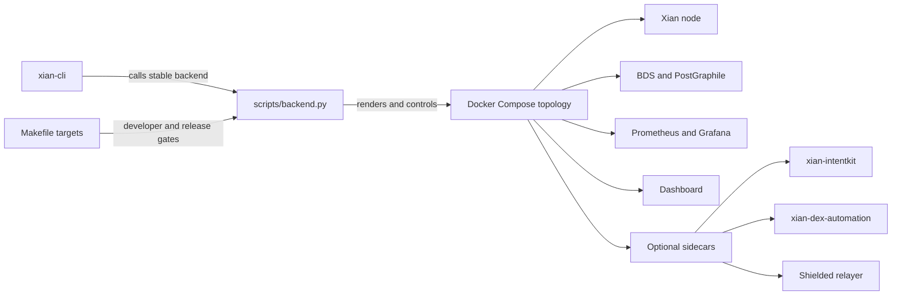

# xian-stack

`xian-stack` is the local runtime backend for Xian. It owns Docker images,
Compose topology, monitoring assets, localnet flows, and backend validation.
It is the implementation surface that sits behind the operator-facing
`xian-cli`, not a primary user-facing tool itself.

The stable machine-facing contract is `scripts/backend.py`. The `Makefile`
is the developer and debugging surface. `xian-cli` is the human-facing
control plane built on top of this backend.

## Runtime Shape



## Quick Start

Validate the stack:

```bash
python3 ./scripts/backend.py validate
make release-safety
```

Run the Python test suite:

```bash
python -m pip install -r requirements-test.txt
python -m pytest -q
```

Run a stack-managed local development node with indexed reads and the local
observability UIs. `start` runs an existing node home (`.cometbft`, with BDS
data in `.bds.db`); it does not create one. Create a fresh single-node chain
with `xian-cli`, which generates a genesis whose only validator and founder is
the node's own key, then start it from this repo:

```bash
# in the sibling xian-cli checkout; the profile home defaults to ../xian-stack/.cometbft
uv run xian network create local-dev --chain-id xian-local-1 \
  --template single-node-dev --generate-validator-key --init-node
```

`make node-configure` builds genesis only from a bundle in `xian-configs`,
whose validator keys are fixed, so it cannot create a chain this node can sign
alone. To start over, stop the node and move `.cometbft` and `.bds.db` aside
before creating the new chain.

```bash
python3 ./scripts/backend.py start  --bds-enabled --dashboard --monitoring
python3 ./scripts/backend.py status --bds-enabled --dashboard --monitoring
python3 ./scripts/backend.py endpoints --bds-enabled --dashboard --monitoring
python3 ./scripts/backend.py health --bds-enabled --dashboard --monitoring
python3 ./scripts/backend.py stop   --bds-enabled --dashboard --monitoring
```

The stack-managed single node configures periodic empty blocks by default
(`XIAN_BLOCK_POLICY_MODE=periodic`, `XIAN_BLOCK_POLICY_INTERVAL=5s`) so local
contract time stays close to wall-clock time during interactive development.
Set `XIAN_BLOCK_POLICY_MODE=on_demand` and `XIAN_BLOCK_POLICY_INTERVAL=0s`
before `make node-configure` only when stale time during idle periods is
acceptable.

The transaction fee policy is chain state written at genesis, never node
configuration. `XIAN_TX_FEE_MODE`, `XIAN_MAX_TX_CHI` and `XIAN_MAX_BLOCK_CHI`
are genesis inputs: `make node-configure` forwards them only together with
`--genesis-bundle` in `CONFIGURE_ARGS` (and refuses them otherwise), and
`localnet-init` builds them into the localnet genesis. The chi caps apply in
every fee mode; an unset variable takes the node's genesis default
(`paid_metered`, 200,000 chi per transaction, 500,000 chi per block).

The stack defaults to fail-closed host bindings:

- CometBFT RPC binds to `127.0.0.1` unless `--public-rpc` is set.
- CometBFT and app metrics bind to `127.0.0.1` unless `--public-metrics` is set.
  The node listens for app metrics on `0.0.0.0:9108` inside the container;
  `XIAN_APP_METRICS_HOST` and `XIAN_APP_METRICS_PORT` (default
  `127.0.0.1:9108`) only choose the host address and port it is published on,
  and a non-loopback host needs `XIAN_PUBLIC_METRICS_ENABLED=1`.
- PostGraphile binds to `127.0.0.1` unless you run a BDS node and pass
  `--public-query` (read-only BDS surface; does not expose live RPC, mempool,
  or raw ABCI traffic).
- The GraphiQL browser UI is available at `http://127.0.0.1:5000/graphiql`
  for interactive queries against the read-only `/graphql` endpoint.
- `endpoints`, `status`, and `health` report the GraphiQL URL, and health marks
  the BDS surface degraded when the browser UI is not reachable.
- Local credentials are generated once into `.stack-secrets.env`, which is
  private and ignored by git. Python, shell, and Make workflows share a literal
  reader; nonempty environment overrides take precedence. See
  [scripts/README.md](scripts/README.md) for the file format.
- BDS uses a dedicated read-only PostgreSQL role for PostGraphile rather than
  the BDS owner account.
- Local stack defaults may use third-party image tags for Postgres,
  Prometheus, and Grafana. Set
  `XIAN_REQUIRE_DIGEST_PINNED_THIRD_PARTY_IMAGES=1` for production/release-style
  validation; then `XIAN_POSTGRES_IMAGE`, `XIAN_PROMETHEUS_IMAGE`, and
  `XIAN_GRAFANA_IMAGE` must use `@sha256:` image refs.

### Localnet

Initialize, start, and exercise a multi-node localnet:

```bash
python3 ./scripts/backend.py localnet-init  --nodes 4 --topology integrated --clean
python3 ./scripts/backend.py localnet-up    --wait-for-health --rpc-timeout-seconds 120
python3 ./scripts/backend.py localnet-workload --scenario counter_basic
```

The generated `docker-compose-localnet.yml` names its own Compose project,
`xian-localnet`, so single-node `make node-stop` / `abci-down` cannot remove
localnet validators as orphans. A compose file generated before this change
keeps the directory project; regenerate it with `localnet-init --clean`.

Bootstrap DEX contracts on a running local node for stack validation. General
DEX installs should use the repo-owned bootstrap script in `xian-dex`; this
make target is a stack validation convenience:

```bash
make localnet-up
make localnet-dex-bootstrap
# or against a specific RPC:
XIAN_DEX_BOOTSTRAP_RPC_URL=http://127.0.0.1:26657 make localnet-dex-bootstrap
```

DEX bootstrap submissions use xian-py's simulation-based automatic chi
estimation by default. Set `XIAN_DEX_CHI_BUDGET_MODE=fixed` only when a
diagnostic or release check must exercise the bundle and bootstrap ceilings
directly.

Higher-level harnesses:

```bash
make localnet-protocol-safety        # 5-validator protocol safety harness
make localnet-e2e                    # layered 5-validator e2e harness
make localnet-parallel-e2e                 # same harness with lower parallel-execution batching
make localnet-vm-tps-bench           # tuned VM throughput sweep
make release-safety                  # full release-grade safety gate
```

For a local run, the harness builds from the sibling checkouts in your workspace.
The hosted Localnet Safety and release gates use the node revisions in
`release-manifest.json` and the CLI, contract catalog, DEX and recovery worker
revisions in `.github/actions/checkout-localnet/action.yml`.

The mandatory `07-dex-automation-recovery` E2E phase requires the `xian-dex` and
`xian-dex-automation` siblings. It deploys the hash-pinned canonical DEX bundle
and a dedicated pool, then checks concurrent evaluation, a killed automation
writer, recovery through another validator during configuration reload, a
reverted swap followed by a successful swap, and an unrelated wallet transfer
while automation is pending. All five nodes must agree on receipts and balances;
nonce and input-debit checks reject duplicate execution. Private test-wallet
inputs are temporary and removed on completion or failure.
The phase also hides receipts for successful and reverted swaps while retaining
real committed nonce reads. Independent rules must trade from the same wallet,
and the original decision must not repeat across worker recreation, RPC reload,
or eventual receipt restoration. Both cases are required in the probe report.

### Optional Sidecars

Shielded relayer (proof-bound private-submission HTTP surface):

```bash
export XIAN_SHIELDED_RELAYER_PRIVATE_KEY=<relayer-ed25519-private-key>
python3 ./scripts/backend.py start --no-bds-enabled --shielded-relayer
```

Defaults to `127.0.0.1`. Binding to a non-loopback host requires
`XIAN_SHIELDED_RELAYER_AUTH_TOKEN`. When enabled, exposes Prometheus metrics
at `/metrics`. Relayer timeout, polling interval, and chi-margin environment
values must be finite numbers. See `docs/` and the relayer environment variables in this
repo's history for the full policy surface
(`XIAN_SHIELDED_RELAYER_*`).

Deterministic DEX automation:

```bash
python3 ./scripts/backend.py start --no-bds-enabled --dex-automation
```

The default admin UI is `http://127.0.0.1:38280`. Config and service-wallet
key file are written under `.artifacts/dex-automation/`. Execution stays
disabled until `wallet.execute=true` in the config. Binding the admin UI to
a non-loopback host requires the same explicit `--public-query` opt-in.

The backend generates a service key only when creating a new configuration.
An existing configuration owns its key source; set
`XIAN_DEX_AUTOMATION_PRIVATE_KEY_FILE` only for an intentional override.
An existing empty key file is treated as damaged custody and is never replaced
automatically. Restore the intended key before starting or bootstrapping.

Automation status reports the effective credential source in
`dex_automation_credential_source`: `kind` is `file`, `environment`, or `null`,
and `source` is the absolute file path or environment-variable name. The
`dex_automation_wallet_key_path` field is `null` unless a file is selected.
Missing or invalid configuration produces a generic
`dex_automation_credential_source_error`, without exposing config or key values.

### Releases

Plan or apply a coordinated workspace release:

```bash
python3 ./scripts/release_orchestrator.py plan
python3 ./scripts/release_orchestrator.py apply
```

Release images are built from digest-pinned base images and checksum-pinned
external inputs, signed by digest, and accompanied by signed release assets.
See `docs/RELEASES.md` for verification commands.

## Runtime Recipes

`xian-stack` has two surfaces by design:

- `scripts/backend.py` is the stable machine contract used by `xian-cli`, CI,
  and automation.
- `make ...` targets are the developer and release-engineering surface for
  image builds, localnet harnesses, and deep validation.

Use the smallest recipe that proves the behavior you care about:

| Need | Command | What it proves |
| --- | --- | --- |
| Single local node with optional services | `python3 ./scripts/backend.py start ...` | Compose wiring, node health, dashboard / monitoring / BDS sidecars |
| Clean multi-node topology | `LOCALNET_NODES=5 make localnet-init && make localnet-up` | Validator topology, genesis distribution, peer connectivity |
| Workload smoke on a running localnet | `make localnet-workload` | Basic contract submission and transaction flow |
| Full 5-validator e2e harness | `make localnet-e2e` | Layered cross-repo behavior, DEX, governance, crash recovery, quorum partitions, fresh-node sync, execution parity, accounting, resource limits, and block replay |
| IntentKit x402 buyer phase | `LOCALNET_E2E_INTENTKIT_X402=1 make localnet-e2e` | Adds a live IntentKit Xian-native x402 payment through a local seller/facilitator |
| Focused IntentKit integration | `make localnet-e2e LOCALNET_E2E_SUITE=intentkit-x402 LOCALNET_E2E_INTENTKIT_X402=1` | Five-node bootstrap, health, compiler and local VM parity, core x402 and required IntentKit payment checks |
| Parallel 5-validator harness | `make localnet-parallel-e2e` | The same e2e program with lower parallel-execution batching |
| Protocol safety harness | `make localnet-protocol-safety` | Validator set, delegation, evidence, governance, and state-patch behavior |
| Release gate | `make release-safety` | Repo validation plus the release-grade localnet gates |

The localnet harnesses are intentionally heavier than a clean topology. A
clean five-node network tells you that the validators can start and peer. The
e2e harness tells you that the product stack still behaves under realistic
contract, indexer, governance, recovery, and restart pressure.

E2E uses the locked `xian-stack` Python environment, including the native
`xian_zk._native` binding used to generate shielded proofs. `make release-safety`
requires this binding before starting the network and fails if the shielded
phase is skipped. To enforce the same requirement in a standalone run, use
`make localnet-e2e LOCALNET_E2E_REQUIRE_SHIELDED=1`. Direct developer runs default
to optional shielded coverage; check the phase summary for skips. Building the
native dependencies on a fresh host requires Rust 1.98 or newer and a C compiler;
the node image builds with Rust 1.100.0.

The independent `IntentKit x402 Integration` workflow runs on manual dispatch,
weekly, and on pull requests affecting its harness. Sibling repository revisions,
including IntentKit, are pinned in `.github/workflows/intentkit-x402.yml`; update
those pins deliberately when validating a dependency change. The focused suite
requires the IntentKit flag and rejects skipped phases. IntentKit uses its frozen
lockfile and the pinned sibling SDK. Its API import is checked before building
the five-node network, and its source/lockfile must remain unchanged afterward.

The payment path uses the real IntentKit tool and HTTP client with a local HTTP
seller and real on-chain settlement. Agent context, signer lookup and order
storage are supplied by the harness; this does not test an LLM agent session or
IntentKit's database persistence. The workflow uploads source revisions, the
phase summary and node report for seven days. Private network/config files and
signed payment payloads are excluded from that artifact.

The E2E run includes 48 seeded accounting operations by default. Set
`LOCALNET_E2E_INVARIANT_ROUNDS` to increase that workload and
`LOCALNET_E2E_SEED` to reproduce a sequence. Recovery checks create temporary
non-validator observers and briefly install crash hooks in disposable test
containers. The hooks are not part of the node image.

The `02-ed25519-genesis` phase checks all five validators reject forged and
noncanonical Ed25519 transactions for a signature error, then commits a contract
verification matrix and compares its results across validators. It also checks
that genesis contract submission timestamps match the shared genesis time in
both the generated state and live node queries.

The `03-contract-functionality` phase deploys eleven authored contracts and runs
214 interactions spanning builtin functions, collections, text/bytes, decimal
ledgers, escrow, batch payments, foreign storage, signatures and time/random
bridges. It checks explicit outcomes and state on all five validators, including
rollback and recovery after expected failures. Canonical deployment also covers
f-strings with nested quoted lookups and dictionary-literal interpolation,
checking their returned values and persisted state. Numeric checks pin portable
float-power bits; two final RNG calls verify exact transaction-context seeding
and agreement across validators. See the
[contract coverage matrix](workloads/e2e/contract_suite/README.md) for scenarios
and limits. The same sources run in a fast native test before network execution.

Runtime regressions run inside the existing contract orchestration, storage,
validator governance, and nonce phases. They check owned-contract access and
metadata permissions, a shared chi budget across serial and nested constructors,
failed-constructor billing and rollback, zero-chi admission rejection without
consuming a nonce, and invalid stored values without interrupting later blocks.
The validator phase rejects registration through an intermediary contract while
retaining the valid validator removal and re-registration flow.

The storage phase also verifies dictionary key equality and duplicate replacement,
large integer/float distinctions, nested list removal, and rollback of writes and
events after an unhashable key. All five validators must agree on receipts and
persisted results, and a follow-up transaction must succeed after the failure.
It also exercises shared references and shallow copies, receiver evaluation order,
mutable defaults, live/lazy/consumable iterators and views, sorting and numeric
builtins, historical hash aliases, selected-object identity, lazy huge ranges and
storage snapshots. Cyclic return values and size-changing dictionary iteration
must roll back writes/events, and the next valid call must still succeed.

Each successful run also exports `replay-corpus/`: public configuration,
CometBFT block databases, expected transaction-result digests, and source
revisions. It excludes application state and validator private keys. The
harness rebuilds application state by replaying every block and compares the
application root, transaction outcomes, chi usage, and events for every block. The scheduled
Localnet Safety workflow repeats this replay on native ARM64 and x86-64 runners.
Each architecture also runs four published-application workflows (68 observations)
through the metered native VM in the same built image, with network access disabled.
Its replay artifact includes application results, logs, image ID and runtime source
revision. These workflows use historical contract sources with controlled inputs;
they do not replay historical public-chain transactions.
For a CI retry of the same evidence, manually dispatch **Localnet Safety** with
`replay_run_id` set to the prior run that uploaded `xian-stack-replay-corpus`.
This skips network generation and runs only the two architecture jobs, checking
out the exact commits recorded in that corpus. It does not validate later code
changes; leave the input empty for a fresh full safety run. Application containers
use the runner's UID/GID so their restricted process can save results without
loosening directory permissions or restoring Linux capabilities.

To replay a retained corpus with another locally built image:

```bash
uv run python scripts/localnet_replay_corpus.py \
  --corpus .artifacts/localnet-e2e/<run-id>/replay-corpus \
  --image xian-node-integrated:local --output .artifacts/replay-check
```

Use a fresh output directory for each replay. See the
[public E2E guide](../xian-docs-web/node/localnet-e2e.md) for the coverage and
interpretation of these checks.

`localnet-e2e` prints `[localnet-e2e] starting ...` and `completed ...` phase
markers. Per-phase JSON, the final node report, and the summary live under
`.artifacts/localnet-e2e/<run-id>/`; use those files to resume or debug a long
run without guessing which layer is active.
Failed phases also retain their error and bounded node/peer/container diagnostics
under `<phase>-failure/nodes.json` before release-gate cleanup.

For automation, prefer the backend command equivalents where available:

```bash
python3 ./scripts/backend.py validate
python3 ./scripts/backend.py localnet-init --nodes 5 --topology integrated --clean
python3 ./scripts/backend.py localnet-up --wait-for-health
python3 ./scripts/backend.py localnet-e2e
```

## Principles

- **Runtime plumbing, not operator UX.** Images, Compose topology, smoke
  flows, and localnet harnesses live here. User-facing lifecycle commands
  live in `xian-cli`.
- **`scripts/backend.py` is the stable machine contract.** External callers
  (CLI, CI, automation) target it. The `Makefile` is for developers and
  debugging.
- **Optional layers stay optional.** Monitoring, dashboard, BDS, shielded
  relayer, DEX automation, and IntentKit are easy to enable without becoming
  required to understand the core node.
- **Fail-closed network bindings.** Loopback by default; public exposure is
  always an explicit opt-in flag.
- **Localnet flows are product safety nets, not product packaging.** They
  smoke-test cross-repo behavior after the core node starts; product repos own
  their installer entrypoints.
- **Independent sibling repos stay independent.** `xian-intentkit` and
  `xian-dex-automation` are attached as optional services without copying
  their topology into this repo.

## Key Directories

- `docker/` — runtime image build definitions for the node and BDS layers.
- `docker-compose-*.yml` — Compose topology files (`abci`, `abci-bds`,
  `abci-dev`, `contracting`, `intentkit`, `localnet`, `monitoring`).
- `scripts/` — backend control plane (`backend.py`), release orchestrator,
  smoke flows, localnet tooling, and TPS benchmarks.
- `monitoring/` — Prometheus, Grafana dashboards (including dedicated
  `Xian VM Runtime` and `Xian BDS Recovery`), and alert variants.
- `workloads/` — localnet workload fixtures and contracts.
- `contracts/` — stack-local runtime contract mount; localnet bootstrap pulls
  product bundles from their owning repos (e.g. `xian-dex`).
- `tests/` — backend, smoke, and harness coverage.
- `docs/` — runtime, release, and governance notes.

## Backend Surface

The stable interface exposed by `scripts/backend.py` covers:

- `validate`
- `start`, `stop`, `status`
- `endpoints`, `health`
- `bds-snapshot-export`, `bds-snapshot-import`
- `smoke`, `smoke-cli`
- `localnet-*` flows
- `localnet-dex-bootstrap` for opt-in canonical DEX deployment
- `localnet-node-report` for fixed VM node capability checks

Use the `Makefile` for lower-level debugging, image builds, and developer
shell access. Use `xian-cli` for human-facing operator workflows.

## Capabilities

- build and run the local Xian runtime in `integrated` or `fidelity` topology
- run canonical-network nodes from pinned published `xian-node` release
  images, with source builds available as a local override
- expose a stable machine-facing backend command surface
  (`scripts/backend.py`)
- start optional dashboard, BDS, Prometheus, and Grafana layers
- start an optional stack-managed DEX automation service for deterministic,
  rule-based DEX actions
- start an optional stack-managed shielded relayer for proof-bound private
  submission
- attach a stack-managed `xian-intentkit` deployment while keeping its repo
  and Compose files independent
- run smoke checks and CLI-driven smoke flows
- initialize multi-node localnets and drive workload scenarios against them
- ship monitoring dashboards and alert rules that match validated operator
  profiles

## Validation

```bash
make validate
make smoke
make smoke-cli
```

`make smoke` is the main repo safety net. `make smoke-cli` is the cross-repo
operator-flow gate. `make release-safety` runs the full release-grade gate
before tagging this repo.

## Related Docs

- [AGENTS.md](AGENTS.md) — repo-specific guidance for AI agents and contributors
- [docs/README.md](docs/README.md) — index of internal docs
- [docs/ARCHITECTURE.md](docs/ARCHITECTURE.md) — major components and dependency direction
- [docs/BACKLOG.md](docs/BACKLOG.md) — open work and follow-ups
- [docs/RELEASES.md](docs/RELEASES.md) — release process, signing, and reproducibility checks
- [docs/RUNTIME_LIMITS.md](docs/RUNTIME_LIMITS.md) — runtime resource limits and policy
- [docs/RUNTIME_RELEASE_BACKLOG.md](docs/RUNTIME_RELEASE_BACKLOG.md) — runtime release follow-ups
- [docs/LOCALNET_PROTOCOL_SAFETY.md](docs/LOCALNET_PROTOCOL_SAFETY.md) — 5-validator protocol safety harness
- [docs/LOCALNET_WORKLOAD_BACKLOG.md](docs/LOCALNET_WORKLOAD_BACKLOG.md) — localnet workload follow-ups
